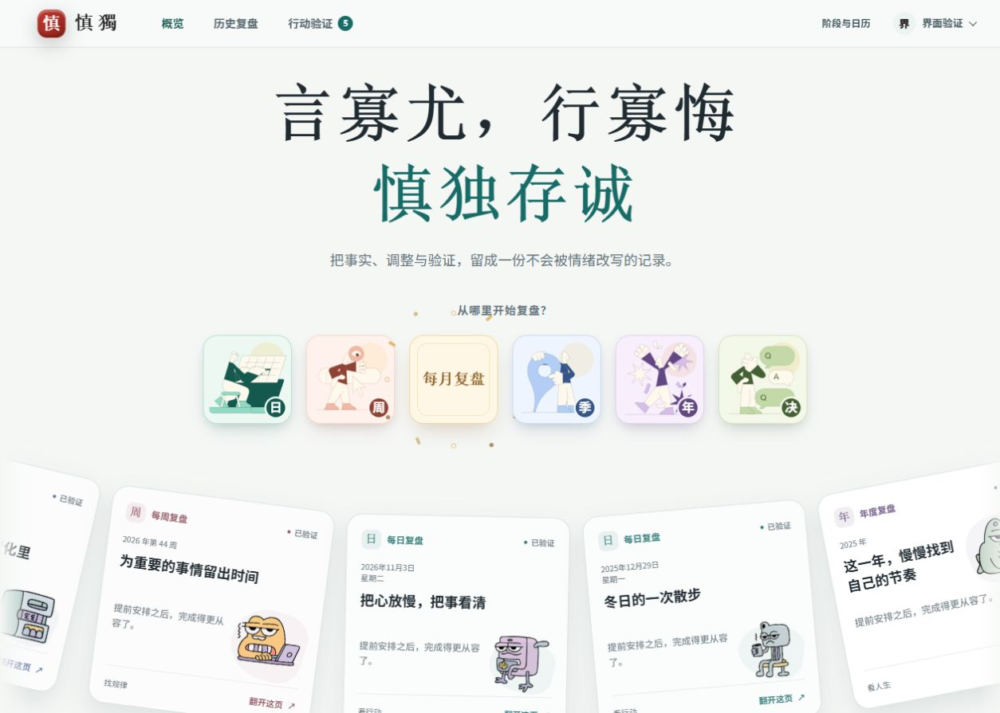

# 慎独 · Shendu v1

[](https://github.com/hikling/shendu-v1/actions/workflows/verify.yml)

给自己使用的个人成长复盘系统。按日、周、月、90 天、年和重大决策记录事实、调整与验证，并在概览里回看已经验证的记录。代码可以公开获取，账户与复盘数据保存在你自己的设备或服务器上。



六类入口插画的来源、语义选择和改色说明见[素材说明](shendu/public/assets/overview/README.md)。

[查看翻面与散开动效](docs/entry-composition-qa/overview-flip-burst.gif) · [查看新版登录首页](docs/entry-composition-qa/login-desktop.png) · [查看固定宽度复盘](docs/entry-composition-qa/daily-1920.png) · [本次界面验收](docs/entry-composition-qa/README.md) · [全站界面验收](docs/flip-ui-qa/README.md)

[查看轮播插画卡片细节](docs/reel-cards.png)

[查看完整 15 张轮播插画](docs/reel-illustrations.png)

[查看新版阶段与日历](docs/ui-polish-qa/stage-desktop.png) · [查看手机月历与状态图例](docs/ui-polish-qa/stage-mobile.png)

[查看新版历史复盘](docs/workspace-design-qa/history-desktop.png) · [查看手机历史页](docs/workspace-design-qa/history-mobile.png)

[查看数据备份](docs/workspace-design-qa/backup-desktop.png) · [查看账户管理](docs/workspace-design-qa/users-desktop.png) · [查看账户与安全](docs/workspace-design-qa/account-desktop.png) · [查看设置](docs/flip-ui-qa/settings-desktop.png) · [界面验收记录](docs/workspace-design-qa/README.md)

[查看行动验证页](docs/actions-overview.png) · [查看验证记录卡](docs/actions-records.png) · [查看验证填写](docs/actions-verification.png) · [查看手机行动验证](docs/actions-mobile.png)

[查看每日复盘引导](docs/daily-intro.png) · [查看分步填写](docs/daily-step.png)

[查看精力场景](docs/daily-energy.png) · [查看02事实书写](docs/daily-writing.png) · [查看03明日行动](docs/daily-action.png) · [查看04日记](docs/daily-journal.png) · [查看原因条目折叠](docs/daily-cause.png) · [查看阻碍与应对同页](docs/daily-plan.png) · [查看紧凑验证日历](docs/daily-calendar.png)

[查看周复盘题目](docs/extended-weekly-step.png) · [查看阻碍与应对](docs/extended-weekly-plan.png) · [查看周复盘引导](docs/extended-weekly.png) · [查看月复盘引导](docs/extended-monthly.png) · [查看90天复盘引导](docs/extended-quarterly.png) · [查看年度复盘引导](docs/extended-yearly.png) · [查看重大决策引导](docs/extended-decision.png) · [查看完整 16 张阶段插画](docs/extended-art-sheet.png)。

## 当前版本

- 登录后进入概览，桌面主句和六类插画均放大，六类入口保持同排：六类彩色插画带有「日、周、月、季、年、决」标记，鼠标悬停或键盘聚焦时在原位翻转，并向四周短促散开类别色粒子，背面仅显示「每日复盘」「每周复盘」「每月复盘」「季度复盘」「年度复盘」「重大决策」。不再展开侧向信息，单击、Enter/Space 或触屏单击直接进入，其他入口不移动；减少动态效果时隐藏粒子并立即切换正反面。下方沿弧线回看已验证记录，以两种插画索引卡版式呈现类别、日期、标题、摘录与真实状态；具体日期分两行显示年月日与完整星期。完整15张本地插画按内容匹配，无法判断时随机并优先避免本轮重复，循环副本外观一致。悬停实际卡片才暂停并抬升、放大；日/周/月/季/年按周期去重，重大事件按事件ID去重，全量内容播完一轮后连续循环。
- 除六类复盘艺术画布外，已登录页面共用精简的无框顶部导航，以文字颜色标记当前页，保留红色印章与宋体「慎獨」字样。六类复盘通过概览图标进入，顶部不再显示复盘菜单。「阶段与日历」只通过顶部按钮打开居中的纸感书页，以每日足迹、当前阶段、待验证三个页签组织内容，不再显示左右六类装饰卡。本周每日复盘、等待验证、累计完成复盘三项统计在底部集中查看，统计仍可跳转。
- 登录、注册和首次管理员页面采用统一的1120px双页书页构图，保留红印章、慎獨宋体和本地晨窗插画，手机上下叠放；原认证流程和密码约束不变。
- 六类复盘的引导、正文与轻量顶部统一居中，以1360px为内容上限；插画、字号和间距同步封顶，宽屏增加两侧留白，手机按原布局重排。
- 每日复盘采用雾蓝艺术画布与内置imagegen生成的8张统一风格插画：睡眠、精力、事实、行动、日期和日记分别有相关场景，01—04按右、左、右、左交错布局。数值与单位相连，状态和带数字、个人基线的参考尺组合在同一纸白面板；睡眠尺0—24小时、精力尺0—100，空值不假装为0。当前分组独立显示在左上角，正文不重复；睡眠/精力面板删除标题及选填标记，保留输入提示。移除题数和右上角回引导；每日画布移除左上logo，保留当前阶段、日期与退出；题目大标题使用加粗宋体。引导改为简短双句并放大字号，保留打字机效果，按中文逗号、句号换行，减少动态效果时直接显示全文；画布用轻量退出与进度操作代替共享顶部菜单。按01今日证据、02事实与原因、03明日行动、04日记逐题填写；02事实与原因可增加最多5条，新增时自动收起已有条目，展开摘要即可修改；阻碍与应对在同页填写并一起检查，其余每屏一个问题；可返回修改、手动保存，原可选项可跳过，必填项在当前题检查，最后完成锁定。退出和失败重试继续保护未保存内容，历史/已锁定记录仍可完整查阅。
- 每日验证日期直接展示紧凑的中文日期笺，圆形日期与居中月份更便于选取；可点击或用键盘选择，过去日期不可选，切换月份不会修改已选值。保存、重载和只读查看继续使用原日期字段。每日插画以静态纸形、细线和小图形丰富构图；标题用更厚的宋体与深青重点词区分主次。
- 周、月、90 天、年度和重大决策复盘也进入逐题艺术画布：先读简短引导，再按原有问题逐题填写；阶段交替左右摆放插画。五类画布分别沿用概览入口的珊瑚红、琥珀金、湖蓝、紫罗兰和橄榄绿，背景、文字、装饰与各阶段插画相互呼应。16 张不同的透明场景插画已生成并按内容接入。必填问题在当前页提示，选填项可跳过；多条记录新增后收起旧项，阻碍与应对同页填写，验证日期直接显示日历。周、月、90 天、年度分别在完成后满 7、30、90、250 个日历日可验证；重大决策至少在完成三个日历月后验证。前端选日、完成锁定与服务端提交遵循同一边界。保存草稿、离开保护、历史只读和原有数据字段继续可用。重大决策的名称独占一步。
- 复盘有草稿、完成锁定、行动验证和历史只读规则；阶段设置可调整问题文案、每日指标与阶段目标。
- 使用固定品牌色与六类独立配色；设置中可单独保存减少动态效果。桌面和手机均可使用。
- 使用本地 SQLite；复盘正文、设置和备份凭据在落盘前加密。支持个人加密备份、整站备份及可选的 WebDAV/S3 外部备份。
- 历史复盘采用紧凑的分类图文卡片：类别与状态置顶，日期、标题和摘要左对齐，插画落在右侧，底部保留打开入口。数据备份、账户管理、账户与安全和设置使用同一家族的纸面、宋体标题、功能配色与相关插画；手机重新分栏，弹窗在内部滚动，原有权限及操作保持有效。

每日插画为内置imagegen生成的本地透明图片，保留PNG原图、无损WebP、完整提示词与SHA256；画风参照六类入口，主题与说明见[每日插画说明](shendu/public/assets/daily/README.md)。

周、月、90 天、年度和重大决策的 16 张插画也由内置 imagegen 生成，保留 PNG、无损 WebP、提示词与哈希。场景和资源映射见[阶段插画说明](docs/extended-illustrations.md)。

六类复盘的题目标题使用 900 字重宋体，桌面 40—64px、手机 32—44px；深墨正文、对应类别强调色和较轻的说明／状态文字形成层级。概览入口悬停或键盘聚焦时在原位翻面，背面仅显示简短类别名称，点击直接进入对应复盘。周、月、季九张阶段图已按对应概览图标重新校准全图色调，见[图标与阶段插画对照](docs/extended-palette-comparison.png)。

六类插画衬底各自采用折页纸、珊瑚叠纸点阵、琥珀圆盘刻度、湖蓝路径格线、紫色年轮轨道、橄榄绿对向纸形，保持低对比、静态且不接收指针；左上角阶段名称跟随概览类别深色。[查看六类衬底与阶段配色](docs/review-category-backdrops.png)。

升级后，已有待验证记录按原完成日重新计算最早验证日期；原预期日期与已验证结果保留。

阶段与日历采用纸感月历和独立页签，标出今天、草稿、已完成和已验证，附文字图例。历史复盘桌面两列、手机单列，保留全文搜索、类型和年月筛选，以及草稿、锁定和已验证记录的原有打开方式；退出历史记录后返回原筛选与阅读位置。配图随站点本地提供，不向外部服务发送复盘内容。

行动验证延续历史复盘的纸感与分类插画，分别呈现待验证和已验证记录，保留原行动、预期／实际日期及完整结果与调整。历史和行动验证共用 **65张已生成并审阅的新插画**：每日30、每周7、每月12、每季4、每年6、重大决策6张。每张有独立场景，细曲线、象牙白人物及类别配色延续概览图标；本地关键词优先匹配，同类图池用完后才复用，筛选及切换页面保持配图稳定。[查看完整插画与来源](art/record-library/README.md) · [每日30张预览](output/imagegen/record-library/contact-daily.png)。网站运行与部署直接使用仓库内图片，**不需要图像API密钥、Python或生成服务**。

通用界面采用本地维护的 **shadcn/ui + React + Radix UI** 组件，使用 Vite 和 Tailwind CSS 构建；原有业务流程由原生 JavaScript 管理。服务端要求 **Node.js 22.13 或更高版本**（推荐与容器一致的 Node.js 24）。组件源码与依赖锁文件随仓库提供，浏览器不加载远程 CDN。生产部署推荐 Debian 12/13、Docker Compose 和项目自带的 Caddy 配置；Docker 会自动安装构建依赖并编译前端。

[组件覆盖与维护说明](docs/shadcn-adoption.md) · [组件迁移验收](docs/shadcn-qa/README.md) · [控件修正与新版阶段日历](docs/ui-polish-qa/README.md)。按钮、表单、菜单、弹窗、日历、面板切换和通知使用真实组件，保留原有红印章、宋体、六类配色、插画与弧形轮播。

轮播使用本地装饰插画，无需上传复盘图片或把正文发送到外部服务；关键词匹配有局限，不代表对情绪的准确判断。素材来源和图案映射见[轮播素材说明](shendu/public/assets/reel-emotions/README.md)。

## 本地运行

已安装 Node.js 22.13+ 和 Git 时：

```bash
git clone https://github.com/hikling/shendu-v1.git
cd shendu-v1/shendu
npm ci
npm run check
npm start
```

`npm start` 会先构建 `public/ui/`，再启动服务。打开 <http://localhost:3000>，注册第一个账户。首次启动会在 `shendu/data/` 自动生成数据库和 `backup-master.key`；本地 HTTP 默认使用非 Secure Cookie。`data/`、`tmp/`、`.env` 和备份文件均已被 Git 忽略。不要把已有部署的数据库放进本地测试目录。

## Debian 12/13 服务器部署

准备一个指向服务器公网 IP 的域名，并在服务器和云厂商防火墙开放 TCP 80、443；需要 HTTP/3 时再开放 UDP 443。[Caddy 会为合格的公网域名自动申请 HTTPS 证书](https://caddyserver.com/docs/automatic-https)。下列命令在 **root shell** 执行；若当前不是 root，先运行 `su -`。这些步骤用于全新安装，已有旧站资料请先看 [迁移与回退](UPGRADING.md)。

### 1. 克隆当前仓库

```sh
apt-get update && apt-get install -y git
git clone https://github.com/hikling/shendu-v1.git /opt/shendu-v1
cd /opt/shendu-v1/shendu
```

### 2. 安装 Docker 并生成环境配置

```sh
sh scripts/install.sh
```

脚本通过 [Docker 官方 Debian 软件源](https://docs.docker.com/engine/install/debian/)安装 Docker Engine 与 Compose 插件，并在首次运行时根据 `.env.example` 创建权限为 `600` 的 `.env`，随机生成 64 位十六进制的 `SHENDU_MASTER_KEY`。已有 `.env` 不会被覆盖。设置实际域名，以下示例只需修改第一行：

```sh
domain=review.example.com
sed -i "s/^SHENDU_DOMAIN=.*/SHENDU_DOMAIN=$domain/" .env
chmod 600 .env
systemctl enable --now docker
docker compose version
docker compose config >/dev/null
```

`SHENDU_DOMAIN` 只写域名，不加 `https://`。使用自带 Caddy 时保留 `SHENDU_SECURE_COOKIE=true`。DNS 尚未指向服务器、80/443 端口被占用或阻断时，HTTPS 证书无法正常签发。

### 3. 启动并核对

```sh
docker compose up -d --build
docker compose ps
domain=$(sed -n 's/^SHENDU_DOMAIN=//p' .env)
curl -fsS "https://$domain/healthz"
```

健康检查应返回含 `"ok":true` 的 JSON。随后打开 `https://你的域名`，注册第一个账户；它会成为超级管理员，并自动关闭公开注册。若未通过健康检查，查看日志：

```sh
docker compose logs --tail=200 shendu
docker compose logs --tail=200 caddy
```

应用容器以普通 `node` 用户运行；入口脚本会为挂载的 `data/`、`tmp/` 校正权限。Caddy 负责 HTTPS 与反向代理。`compose.yaml` 将数据目录挂载到宿主机，因此重建容器不会删除数据库。前端在镜像的独立构建阶段执行 `npm ci` 与 `npm run build`；运行镜像只包含服务端、静态资源和编译产物，无需在服务器宿主机安装 Node.js。

## 更新现有 shendu-v1 部署

在 root shell 执行：

```sh
sh /opt/shendu-v1/shendu/scripts/update.sh /opt/shendu-v1
```

更新脚本要求 `/opt/shendu-v1` 是本仓库的 `main` 分支 Git 克隆、受版本控制的文件没有本地改动，并且 `.env` 存在。脚本会在拉取代码前询问是否生成整站加密快照；建议输入 `y`。选择备份且失败时，更新会停止。之后脚本会拉取 `origin/main`、构建新镜像、等待应用健康，再启动完整服务。手工核对：

```sh
cd /opt/shendu-v1/shendu
docker compose ps
docker compose logs --tail=100 shendu
```

请勿在更新时删除或替换 `.env`、`data/`、`data/backup-master.key` 和 Docker 的 Caddy 卷。从原 `Shendu` 仓库、ZIP 目录或其他路径迁移，请按 [UPGRADING.md](UPGRADING.md) 保留原始数据与密钥。

## 数据与备份

| 路径（相对于 `shendu/`） | 用途 |
| --- | --- |
| `data/shendu.db` | SQLite 数据库及 WAL 文件 |
| `data/backup-master.key` | 服务器内部加密主密钥；丢失后原数据库无法解密 |
| `data/server-backup.password` | 首次创建服务器整站快照时生成的恢复密码 |
| `backups/*.shendu-db` | 服务器整站加密快照 |
| `tmp/` | 导入及备份过程中的临时文件 |

可在应用内导出个人 `.shendu` 备份；超级管理员可导出 `.shendu-site` 整站包。服务器端也可运行 `sh scripts/site-backup.sh` 生成 `.shendu-db` 快照。备份文件和密码应分别保存到服务器之外。服务器管理员拥有运行时解密能力，因此还需保护主机、`.env`、数据库和密钥。仓库公开不代表这些运行数据公开。

## 开发与检查

在 `shendu/` 目录执行：

```sh
npm ci
npm run check
npm test
```

`npm test` 会先构建组件资源，再使用隔离的临时数据环境检查组件兼容、账户隔离、加密和备份等行为，不应指向生产 `data/`。`npm run build` 可单独重建组件资源；`npm run dev` 先构建一次，再监视服务端文件，修改 `ui/` 后需重新运行构建并刷新页面。组件源码位于 `shendu/ui/components/ui/`，接入方式和适用边界见[组件覆盖说明](docs/shadcn-adoption.md)，许可证见[第三方声明](THIRD-PARTY-NOTICES.md)。Trellis 的产品方向、设计约定与任务记录分别在 `PRODUCT.md`、`DESIGN.md`、`UX-CONTRACT.md` 和 `.trellis/`。

仓库的 [构建检查](.github/workflows/verify.yml)会在 Linux 上安装锁定依赖、构建组件、运行脚本与测试、解析 Compose 配置、构建 Docker 镜像，并启动容器检查 `/healthz`、HTML 与实际 JavaScript/CSS 资源。本地启动后可运行 `npm run smoke:ui -- http://127.0.0.1:3000` 检查这些资源。

新版界面截图：[紧凑日历](docs/calendar-compact.jpg)、[宽幅历史复盘](docs/history-wide.jpg)、[行动验证阅读区](docs/actions-layout-qa/verified-desktop.png)、[手机行动验证](docs/actions-layout-qa/verified-mobile.png)、[手机历史复盘](docs/history-art-mobile.jpg)。行动验证大插画、数量与日期排版见[本次验收记录](docs/actions-layout-qa/README.md)。从历史复盘或行动验证打开记录，退出后返回原列表并保留历史筛选。插画完整预览见[本地画廊](output/imagegen/record-library/gallery.html)。
