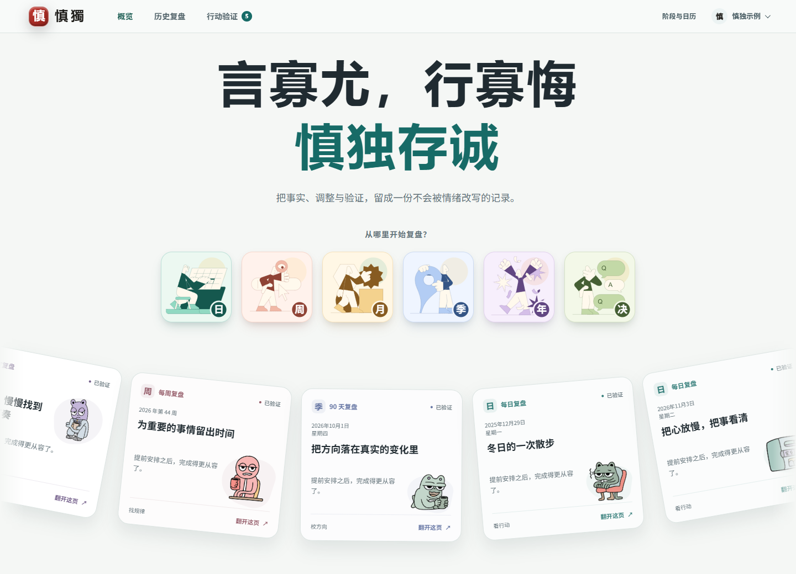

<div align="center">

# 慎独 · Shendu v1

**言寡尤，行寡悔 · 慎独存诚**

给自己用的个人成长复盘系统。记录事实，调整行动，回来验证。

[](https://github.com/hikling/shendu-v1/actions/workflows/verify.yml)

[快速部署](#debian-1213-服务器部署) · [本地运行](#本地运行) · [完整部署指南](docs/deployment.md) · [迁移旧站](UPGRADING.md)

</div>



## 从记录，到行动，再到验证

六种时间尺度，共同组成一份持续积累的个人成长记录。

| 复盘 | 关注什么 |
| --- | --- |
| 每日复盘 | 留下事实，找到明天最重要的一件事 |
| 每周复盘 | 回看进展，辨认反复出现的规律 |
| 每月复盘 | 调整目标与系统，尝试一个小实验 |
| 90 天复盘 | 校准方向，为下一阶段作出取舍 |
| 年度复盘 | 回看人生坐标，确定新一年的主题 |
| 重大决策 | 记录依据、预期和选择，等待结果检验 |

- **安静地写**：逐题填写、手动保存草稿；完成后锁定，保留当时的判断。
- **按时回来**：行动验证保留原计划、预期日期、实际结果与下一次调整。
- **慢慢回看**：历史复盘可搜索和筛选；概览沿弧线轮播已经验证的记录。
- **看见积累**：阶段与日历汇总每日足迹、农历节气、阶段目标和待验证行动。
- **自己保管**：自托管 SQLite、账户隔离、数据加密，以及个人、整站和外部备份。

桌面与手机共用纸感界面、宋体和六类插画配色，并支持减少动态效果。插画、装饰字体和前端资源随仓库提供，中文字体使用本机字体回退；**运行时不需要图像 API 密钥或外部生成服务**。

## Debian 12/13 服务器部署

推荐使用仓库自带的 **Docker Compose + Caddy**。准备指向服务器的域名，开放 TCP 80、443；如需 HTTP/3，再开放 UDP 443。以下在 **root shell** 执行，已有站点先看[更新说明](#更新现有-shendu-v1-部署)或[迁移指南](UPGRADING.md)。

**1. 下载项目并安装 Docker**

```sh
apt-get update && apt-get install -y git
git clone https://github.com/hikling/shendu-v1.git /opt/shendu-v1
cd /opt/shendu-v1/shendu
sh scripts/install.sh
```

安装脚本会从 Docker 官方 Debian 源安装 Engine 和 Compose，并首次生成 `.env` 与随机加密主密钥；已有 `.env` 不会被覆盖。

**2. 设置域名并启动**

把第一行改成你的实际域名，不带 `https://`：

```sh
shendu_domain=review.example.com
sed -i "s/^SHENDU_DOMAIN=.*/SHENDU_DOMAIN=$shendu_domain/" .env
chmod 600 .env
systemctl enable --now docker
docker compose config >/dev/null
docker compose up -d --build
```

**3. 检查并打开网站**

```sh
docker compose ps
curl -fsS "https://$shendu_domain/healthz"
```

返回含 `"ok":true` 的 JSON 后，打开你的 HTTPS 域名。第一个注册账户会成为超级管理员，随后自动关闭公开注册。Docker 会自动构建前端，服务器宿主机无需安装 Node.js。

遇到问题，查看[完整部署、配置与故障处理](docs/deployment.md)。

## 本地运行

需要 **Git、Node.js 22.13+**，推荐与容器一致的 Node.js 24。

```sh
git clone https://github.com/hikling/shendu-v1.git
cd shendu-v1/shendu
npm ci
npm start
```

打开 <http://localhost:3000>。`npm start` 会先构建前端，再启动服务；首次运行自动生成 `shendu/data/` 中的数据库和内部主密钥。自定义端口与目录见[本地环境说明](docs/deployment.md#本地-nodejs-运行)。

## 更新现有 shendu-v1 部署

在 root shell 执行：

```sh
sh /opt/shendu-v1/shendu/scripts/update.sh /opt/shendu-v1
```

脚本会询问是否先创建整站加密快照，建议输入 `y`；然后拉取 `origin/main`、重新构建并检查容器健康。它要求部署目录是无本地代码改动的 `main` 分支 Git 克隆，并保留现有 `.env`。完整过程见[更新与检查](docs/deployment.md#更新与检查)。

## 数据与备份

数据库与原主密钥需要一起保管。重建容器会保留挂载的数据目录；不要在升级时删除 `.env`、`data/` 或 Caddy 卷。

| 需要保存什么 | 使用方式 |
| --- | --- |
| 个人资料 | 在「数据备份」导出加密的 `.shendu` 文件 |
| 整个站点 | 超级管理员导出 `.shendu-site`，或在服务器生成 `.shendu-db` 快照 |
| 另一处副本 | 连接 WebDAV / S3，手动、每天或每周备份 |

[数据目录、密钥与恢复说明](docs/deployment.md#数据与备份) · [旧 Shendu / ZIP 部署迁移与回退](UPGRADING.md)

## 开发与检查

在 `shendu/` 中执行：

```sh
npm ci
npm run check
npm test
```

`npm test` 会先构建前端，再运行隔离测试；`npm run build` 可单独构建，`npm run dev` 监视服务端文件。修改 `ui/` 后需重新构建并刷新页面。启动后可运行 `npm run smoke:ui -- http://127.0.0.1:3000` 检查健康状态和实际静态资源。

技术栈：**Node.js · SQLite · 原生 JavaScript · React · shadcn/ui · Radix UI · Tailwind CSS · Vite**。浏览器使用本地构建资源，不加载远程组件 CDN。

## 项目文档

| 使用与维护 | 设计与实现 |
| --- | --- |
| [完整部署指南](docs/deployment.md) | [产品方向](PRODUCT.md) · [设计约定](DESIGN.md) |
| [迁移与回退](UPGRADING.md) | [交互契约](UX-CONTRACT.md) · [组件接入](docs/shadcn-adoption.md) |
| [构建与容器检查](.github/workflows/verify.yml) | [插画与素材来源](art/record-library/README.md) · [第三方声明](THIRD-PARTY-NOTICES.md) |

代码公开，运行中的账户、复盘资料、数据库与密钥由部署者自行保管。服务器管理员持有运行时解密能力，相关边界见[加密与账户归属](docs/deployment.md#加密与账户归属)。
