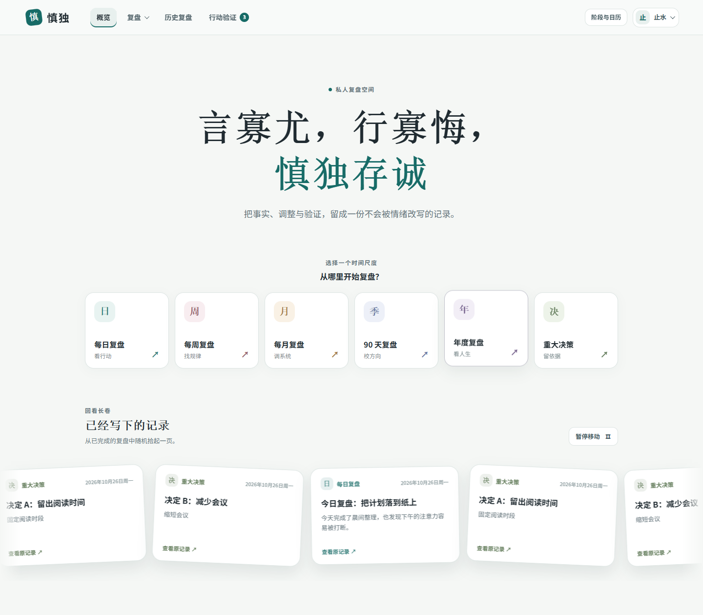

# 慎独 · Shendu v1

[](https://github.com/hikling/shendu-v1/actions/workflows/verify.yml)

给自己使用的个人成长复盘系统。按日、周、月、90 天、年和重大决策记录事实、调整与验证，并在概览里回看已经完成的记录。代码可以公开获取，账户与复盘数据保存在你自己的设备或服务器上。



六类入口插画的来源、语义选择和改色说明见[素材说明](shendu/public/assets/overview/README.md)。

[查看放大后的桌面入口](docs/overview-row.png) · [查看入口信息卡](docs/overview-info.png)

[查看轮播插画卡片细节](docs/reel-cards.png)

[查看完整 15 张轮播插画](docs/reel-illustrations.png)

[查看顶部复盘菜单](docs/top-navigation.png)

[查看居中的阶段与日历](docs/stage-calendar.png)

[查看每日复盘引导](docs/daily-intro.png) · [查看分步填写](docs/daily-step.png)

[查看精力场景](docs/daily-energy.png) · [查看02事实书写](docs/daily-writing.png) · [查看03明日行动](docs/daily-action.png) · [查看04日记](docs/daily-journal.png) · [查看原因条目折叠](docs/daily-cause.png) · [查看阻碍与应对同页](docs/daily-plan.png) · [查看紧凑验证日历](docs/daily-calendar.png)

## 当前版本

- 登录后进入概览，桌面主句和六类插画均放大，六类入口保持同排：六类彩色插画带有「日、周、月、季、年、决」标记，鼠标悬停或键盘聚焦时原位放大、增强阴影，并从左侧展开类别、用途、说明、预计时间和「进入复盘」入口，四周伴随短促散开粒子。图标保持正向，单击图标或介绍中的按钮均可直接进入，其他图标不移动；触屏同样单击直达，窄屏自动调整介绍位置。下方沿弧线回看已验证记录，以两种插画索引卡版式呈现类别、日期、标题、摘录与真实完成状态；具体日期分两行显示年月日与完整星期；插画根据复盘中的明确关键词在本地选择，完整15张插画全部参与选择，无法判断时随机并优先避免本轮重复；循环副本外观一致。悬停卡片会暂停并明显抬升、放大，轮播只展示“已验证”记录，日/周/月/季/年按周期去重并保留最近验证版本，重大事件按事件ID去重；全量内容完整播完一轮后再循环，完整轮次连续衔接；轨道按卡片旋转和悬停范围预留空间，保持上下边角完整。
- 除每日艺术画布外，已登录页面共用精简的无框顶部导航，以文字颜色标记当前页，保留红色印章与宋体「慎獨」字样；复盘下拉按两列显示用途与时长，支持键盘操作。「阶段与日历」只通过顶部按钮打开居中弹窗，关闭时不占右侧栏；本周每日复盘、等待验证、累计完成复盘三项统计集中在这里，与阶段、彩色日历和待验证事项一起查看，统计仍可跳转。桌面两侧各有三类图标，手机上排列在弹窗顶部。
- 每日复盘采用雾蓝艺术画布与内置imagegen生成的8张统一风格插画：睡眠、精力、事实、行动、日期和日记分别有相关场景，01—04按右、左、右、左交错布局。数值与单位相连，状态和带数字、个人基线的参考尺组合在同一纸白面板；睡眠尺0—24小时、精力尺0—100，空值不假装为0。当前分组独立显示在左上角，正文不重复；睡眠/精力面板删除标题及选填标记，保留输入提示。移除题数和右上角回引导；每日画布移除左上logo，保留当前阶段、日期与退出；题目大标题使用加粗宋体。引导改为简短双句并放大字号，保留打字机效果，按中文逗号、句号换行，减少动态效果时直接显示全文；画布用轻量退出与进度操作代替共享顶部菜单。按01今日证据、02事实与原因、03明日行动、04日记逐题填写；02事实与原因可增加最多5条，新增时自动收起已有条目，展开摘要即可修改；阻碍与应对在同页填写并一起检查，其余每屏一个问题；可返回修改、手动保存，原可选项可跳过，必填项在当前题检查，最后完成锁定。退出和失败重试继续保护未保存内容，历史/已锁定记录仍可完整查阅。
- 每日验证日期直接展示紧凑的中文日期笺，圆形日期与居中月份更便于选取；可点击或用键盘选择，过去日期不可选，切换月份不会修改已选值。保存、重载和只读查看继续使用原日期字段。每日插画以静态纸形、细线和小图形丰富构图；标题用更厚的宋体与深青重点词区分主次。
- 复盘有草稿、完成锁定、行动验证和历史只读规则；阶段设置可调整问题文案和 90 天菜单入口。
- 支持主题、自定义颜色及减少动态效果。桌面和手机均可使用。
- 使用本地 SQLite；复盘正文、设置和备份凭据在落盘前加密。支持个人加密备份、整站备份及可选的 WebDAV/S3 外部备份。

每日插画为内置imagegen生成的本地透明图片，保留PNG原图、无损WebP、完整提示词与SHA256；画风参照六类入口，主题与说明见[每日插画说明](shendu/public/assets/daily/README.md)。

本项目没有前端构建步骤，也没有第三方 npm 运行依赖。服务端要求 **Node.js 22.13 或更高版本**（推荐与容器一致的 Node.js 24）；生产部署推荐 Debian 12/13、Docker Compose 和项目自带的 Caddy 配置。

轮播使用本地装饰插画，无需上传复盘图片或把正文发送到外部服务；关键词匹配有局限，不代表对情绪的准确判断。素材来源和图案映射见[轮播素材说明](shendu/public/assets/reel-emotions/README.md)。

## 本地运行

已安装 Node.js 22.13+ 和 Git 时：

```bash
git clone https://github.com/hikling/shendu-v1.git
cd shendu-v1/shendu
npm run check
npm start
```

打开 <http://localhost:3000>，注册第一个账户。首次启动会在 `shendu/data/` 自动生成数据库和 `backup-master.key`；本地 HTTP 默认使用非 Secure Cookie。`data/`、`tmp/`、`.env` 和备份文件均已被 Git 忽略。不要把已有部署的数据库放进本地测试目录。

## Debian 12/13 服务器部署

准备一个指向服务器公网 IP 的域名，并在服务器和云厂商防火墙开放 TCP 80、443；需要 HTTP/3 时再开放 UDP 443。[Caddy 会为合格的公网域名自动申请 HTTPS 证书](https://caddyserver.com/docs/automatic-https)。下列命令在 **root shell** 执行；若当前不是 root，先运行 `su -`。这些步骤用于全新安装，已有旧站资料请先看 [迁移与回退](UPGRADING.md)。

### 1. 克隆当前仓库

```sh
apt-get update && apt-get install -y git
git clone https://github.com/hikling/shendu-v1.git /opt/shendu-v1
cd /opt/shendu-v1/shendu
```

### 2. 安装 Docker 并生成环境配置

```sh
sh scripts/install.sh
```

脚本通过 [Docker 官方 Debian 软件源](https://docs.docker.com/engine/install/debian/)安装 Docker Engine 与 Compose 插件，并在首次运行时根据 `.env.example` 创建权限为 `600` 的 `.env`，随机生成 64 位十六进制的 `SHENDU_MASTER_KEY`。已有 `.env` 不会被覆盖。设置实际域名，以下示例只需修改第一行：

```sh
domain=review.example.com
sed -i "s/^SHENDU_DOMAIN=.*/SHENDU_DOMAIN=$domain/" .env
chmod 600 .env
systemctl enable --now docker
docker compose version
docker compose config >/dev/null
```

`SHENDU_DOMAIN` 只写域名，不加 `https://`。使用自带 Caddy 时保留 `SHENDU_SECURE_COOKIE=true`。DNS 尚未指向服务器、80/443 端口被占用或阻断时，HTTPS 证书无法正常签发。

### 3. 启动并核对

```sh
docker compose up -d --build
docker compose ps
domain=$(sed -n 's/^SHENDU_DOMAIN=//p' .env)
curl -fsS "https://$domain/healthz"
```

健康检查应返回含 `"ok":true` 的 JSON。随后打开 `https://你的域名`，注册第一个账户；它会成为超级管理员，并自动关闭公开注册。若未通过健康检查，查看日志：

```sh
docker compose logs --tail=200 shendu
docker compose logs --tail=200 caddy
```

应用容器以普通 `node` 用户运行；入口脚本会为挂载的 `data/`、`tmp/` 校正权限。Caddy 负责 HTTPS 与反向代理。`compose.yaml` 将数据目录挂载到宿主机，因此重建容器不会删除数据库。

## 更新现有 shendu-v1 部署

在 root shell 执行：

```sh
sh /opt/shendu-v1/shendu/scripts/update.sh /opt/shendu-v1
```

更新脚本要求 `/opt/shendu-v1` 是本仓库的 `main` 分支 Git 克隆、受版本控制的文件没有本地改动，并且 `.env` 存在。脚本会在拉取代码前询问是否生成整站加密快照；建议输入 `y`。选择备份且失败时，更新会停止。之后脚本会拉取 `origin/main`、构建新镜像、等待应用健康，再启动完整服务。手工核对：

```sh
cd /opt/shendu-v1/shendu
docker compose ps
docker compose logs --tail=100 shendu
```

请勿在更新时删除或替换 `.env`、`data/`、`data/backup-master.key` 和 Docker 的 Caddy 卷。从原 `Shendu` 仓库、ZIP 目录或其他路径迁移，请按 [UPGRADING.md](UPGRADING.md) 保留原始数据与密钥。

## 数据与备份

| 路径（相对于 `shendu/`） | 用途 |
| --- | --- |
| `data/shendu.db` | SQLite 数据库及 WAL 文件 |
| `data/backup-master.key` | 服务器内部加密主密钥；丢失后原数据库无法解密 |
| `data/server-backup.password` | 首次创建服务器整站快照时生成的恢复密码 |
| `backups/*.shendu-db` | 服务器整站加密快照 |
| `tmp/` | 导入及备份过程中的临时文件 |

可在应用内导出个人 `.shendu` 备份；超级管理员可导出 `.shendu-site` 整站包。服务器端也可运行 `sh scripts/site-backup.sh` 生成 `.shendu-db` 快照。备份文件和密码应分别保存到服务器之外。服务器管理员拥有运行时解密能力，因此还需保护主机、`.env`、数据库和密钥。仓库公开不代表这些运行数据公开。

## 开发与检查

在 `shendu/` 目录执行：

```sh
npm run check
npm test
```

`npm test` 使用隔离的临时数据环境检查账户隔离、加密和备份等行为，不应指向生产 `data/`。界面使用原生 JavaScript、HTML 和 CSS；Trellis 的产品方向、设计约定与任务记录分别在 `PRODUCT.md`、`DESIGN.md`、`UX-CONTRACT.md` 和 `.trellis/`。

仓库的 [构建检查](.github/workflows/verify.yml)会在 Linux 上运行脚本与测试、解析 Compose 配置、构建 Docker 镜像，并启动容器检查 `/healthz`。
