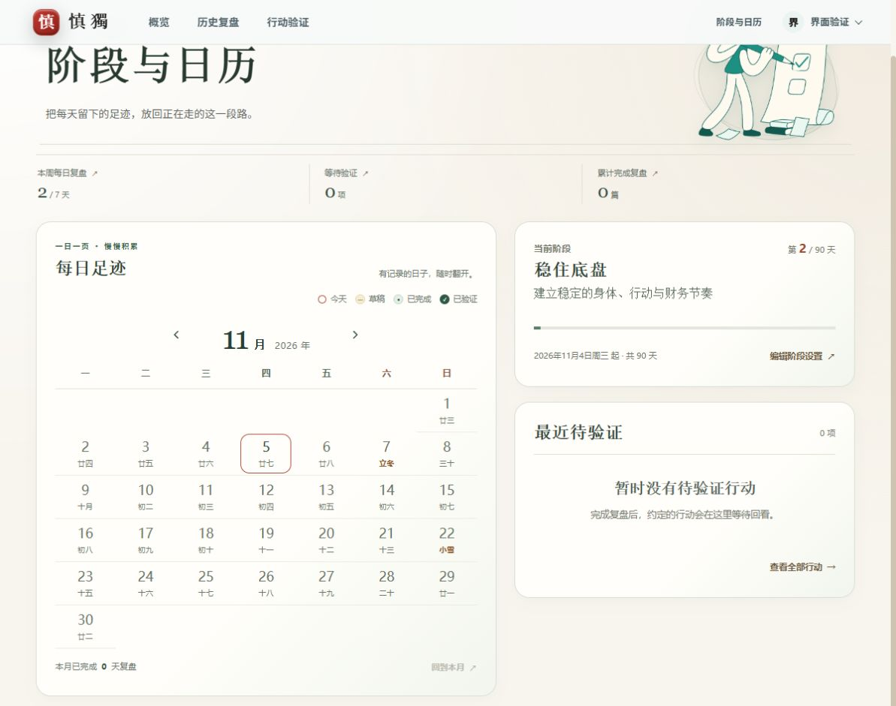
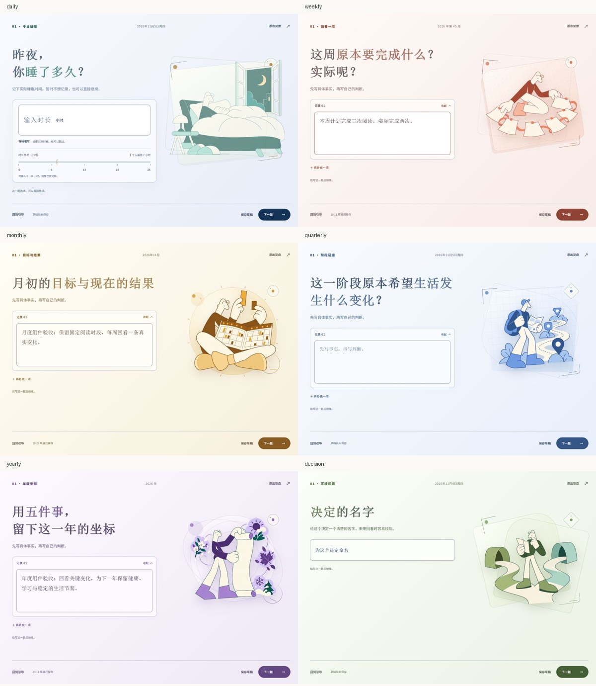

# 月历布局与六类渐变验收

2026-11-05，生产构建与隔离合成夹具；真实账户、记录及偏好未修改。

- 月份/年份居中位于两侧切换箭头之间；今天、草稿、已完成、已验证图例移到月历顶部右侧。
- 修正共享日期按钮误用格子类名的问题：按钮为rdp-day_button，td为rdp-day，阶段日历格子规则限定实际td。
- 新构建的空记录月历在320/390/820/1000/1100/1280px、反复切月、跨2027年及重新进入后均无重复日期；2026年11月30个真实日期各出现一次，首周只在周日显示1/廿三，外月格为空。月份按钮键盘焦点保持，浏览不选择日期。手机图例无重叠，无横向溢出。
- 合成已验证记录从日历进入，查看验证日期后退出，返回原月份和原日期焦点。复盘验证月历仍为六周七列，原2026-11-04选中日期、锁定和禁用行为保持。
- 六类开场及编辑的计算背景相同，使用135度静态渐变：各类daily-white浅纸白 → 混合色 → 原daily-paper，六种终点色未变。六类桌面及真实390px逐题检查均可读，没有横向溢出；图像和输入表面保持原样。
- 两个验收页控制台没有error/warn。DOM值、日期唯一性和计算背景见[geometry.json](geometry.json)。

用户截图中重复绘制的具体环境问题未在旧基线本地浏览器复现；已确认并消除类名/格子样式冲突。以上新构建观察不等于声称确认了该环境的绘制根因。

## 截图

[320px空月历](calendar-empty-320.png) · [390px空月历](calendar-empty-390.png) · [820px空月历](calendar-empty-820.png) · [有记录的月历与返回](calendar-record-return.png) · [只读验证月历](verification-locked.png)

[每日](gradient-daily.png) · [每周](gradient-weekly.png) · [每月](gradient-monthly.png) · [季度](gradient-quarterly.png) · [年度](gradient-yearly.png) · [重大决策](gradient-decision.png) · [390px周复盘](gradient-weekly-390.png)

## 检查

- build / check通过；完整测试150/150。
- 本地健康、HTML、app及本地shadcn JS/CSS资源烟测通过。
- 独立审查未发现额外缺陷，相关组件回归8/8通过。
- `git diff --check`通过；README、DESIGN、组件说明及规范已更新。

功能提交 `443189a4e3882735deae55216c50e3f885e58d08` 已同步 main；对应 [GitHub Actions 42024625579](https://github.com/hikling/shendu-v1/actions/runs/42024625579) 已成功，覆盖 Linux 构建、检查、测试与 Docker/资源烟测。Trellis 归档和日志随后单独提交。
