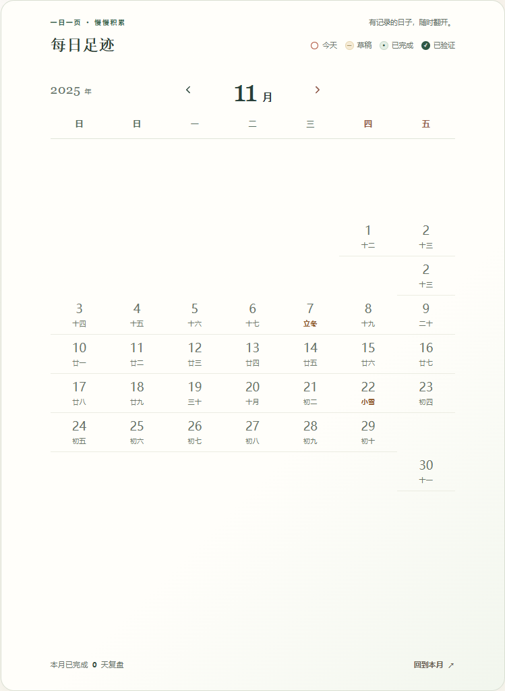
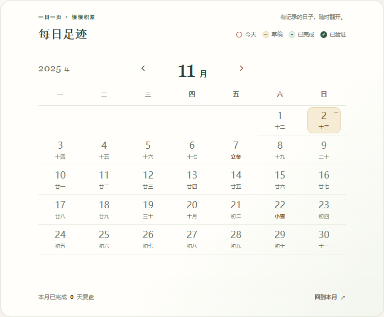

# Chrome 秋季日历回归

范围：只修阶段与日历的日期计算。页头、年份／月份布局、图例、统计、侧栏、共享验证日历和其他页面不变。

## 证据与修复

- 用户报告：Chrome 安装 My Fingerprint，历年十月／十一月日期重复及异常空行；Edge 正常。线上 `stagegrid2` 的下载模块与本地构建一致。
- 普通 Chrome／Edge、正常时区及 DST 切换未复现。先前仅从布局、空白占位和 CSS 角度处理，没有覆盖日期 API 被不一致改写的环境。
- 在旧构建安装受控的混合 Date 改写：上海系统时区、纽约 local getters／部分 setters，保留原生 `setDate`。Chrome 的 2025 年 11 月出现 31 个按钮、30 个唯一日期，重复 2 日／十三；十月也出现外月日期和累计周行。星期标题同时被移位。
- 修复：阶段专用 civil Date 实例用 UTC 字段承载传入的 YYYY-MM-DD，实例本地 getter/setter 均读取／修改同一组字段；日期克隆保留类型，DateLib 的 newDate／today、初始月份、今天和返回本月都走此路径。没有把保存日期转成 UTC 时间点，没有全局 Date 改写。
- 农历的纯公历字段验证与月底计算也使用 UTC 字段，传给农历库的年月日不变。实际 Date 输入继续按其显式日历字段解释。
- 不能只加 `timeZone="UTC"`／TZDate：研究中的这条路径仍受混合系统 offset 影响。无需新增依赖。

受控环境复现了相同的重复日期／异常行症状；未取得 My Fingerprint 源码或连接用户的实际 Chrome 会话，不能宣称已验证其具体实现。此修复防止的是已复现的日期 API 混用。没有改用户插件或浏览器设置。

| 2025 年 11 月 | 截图 |
| --- | --- |
| 旧构建，混合 Date 环境 |  |
| stagecivil1，同种环境 |  |

十月对照： [旧构建](baseline-hybrid-2025-10.png)、[修复后](fixed-hybrid-2025-10.png)。窄屏：[320px](fixed-hybrid-320.png)。所有数据均来自隔离的合成账户，验收不保存或验证记录。

## 自动验证

- `npm test`：153/153 通过（含构建）。新增实际生产组件回归在旧代码失败、修复后通过；覆盖混合 getter/setter、多个秋季和跨年、记录身份、农历、导航焦点和旧日期节点清理。
- `npm run check`、`npm run smoke:ui -- http://127.0.0.1:3192`、`git diff --check` 通过。
- `check.cjs`：792 次 Chrome／Edge 月份及布局验证，Chrome157.0.8103.38、Edge156.0.4314.58。Chrome normal／offset-only／local-getters／partial-setters，Edge normal／partial-setters。每个模式连续回切38月、前进76月，随后检查返回本月、820/390/320px和原始记录进入／退出。完整输出在 `final-checks.json`。
- 独立比较每个日期的真实位置与 UTC 公历星期列／周行；断言顺序与数量、六行七格、农历非空、星期标题、无横向溢出、导航节点及焦点稳定、旧日期移除。插件模拟在应用模块导入之前安装。
- 已有 `docs/stage-placement-qa/check.cjs` 48项仍通过：含缩放、占位格隐藏、空月、原记录返回和 reduced motion。
- 独立审查：2000–2050全年 × 三个系统时区 × 三种模拟，5508个模型通过；详见本任务 `review.md`。精确插件实现仍是证据边界。

可复跑（需本机 Playwright、Chrome／Edge和已认证的隔离夹具）：

```powershell
$env:PLAYWRIGHT_MODULE='绝对路径/node_modules/playwright'
$env:CHROME_EXECUTABLE_PATH='C:/Program Files/Google/Chrome/Application/chrome.exe'
$env:EDGE_EXECUTABLE_PATH='C:/Program Files (x86)/Microsoft/Edge/Application/msedge.exe'
node docs/chrome-autumn-qa/check.cjs http://127.0.0.1:3192
```

## Main 与运行版本

- 修复提交：`d583e789f32da4d1fc27d4fa088c0b739ad9bb3a`，已推送 `origin/main`。
- [该准确 SHA 的 Linux CI](https://github.com/hikling/shendu-v1/actions/runs/42175958741) 已完成且 success，含脚本／153测试、Docker构建与容器启动／静态资源 smoke。
- UI 缓存修订为 `1.0.0-stagecivil1`。推送后读取 `https://cokee.cc.cd/` 的公开 HTML，仍为 `stagegrid2`；该线上实例尚需部署新的构建。本任务没有操作生产服务器或用户浏览器，不将 main／CI 成功等同于线上已升级。
- 验收结束已关闭隔离夹具；3192、3193均返回 ECONNREFUSED。
