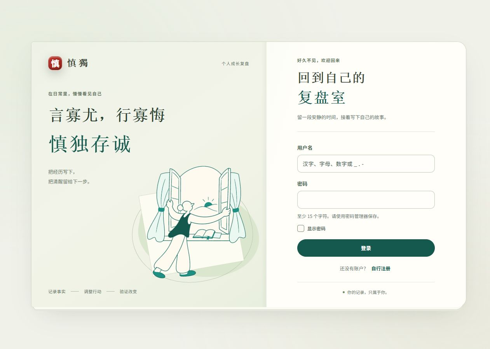

# 登录首页、翻面散开与复盘宽度验收

2026-11-05，任务 [entry-composition-and-review-width](../../.trellis/tasks/archive/2026-11/11-05-entry-composition-and-review-width/prd.md)。本次仅调整概览入口、认证首页与六类复盘的构图宽度；记录、认证、保存、验证等待期和轮播规则未改动。

## 实际页面

上图由真实浏览器连续12帧录制，截取入口区域；播放结束额外停留1.2秒便于查看。GIF自身循环播放，页面动效只在进入悬停或键盘可见焦点时播放一次。

认证首页使用1120px上限的双页书页。登录、注册、首次管理员保持原字段和真实控件，窄屏上下叠放，可正常滚动到提交按钮。

## 浏览器结果

- 概览：1280px下翻面和12粒子同时呈现；散开层与正反面均不接收指针，原六个按钮位置不变。Enter进入每日、Space进入每周、鼠标进入其余四类均成功，退出回到来源。标题缩为 .78rem。实测截图见 [瞬间](overview-flip-burst.png)。
- 减少动态：隔离账户设置为reduceMotion时，320px下六个散开层全部display:none，六个翻面容器transform:none、transition:0s，无横向溢出；保留可见键盘焦点和类别背面。[截图](overview-reduced-320.png)。系统偏好路径由相同CSS规则和独立代码复核覆盖，本轮未切换操作系统设置。
- 登录：首页1280×900书页宽1120px，左右80px留白。显示密码切换确实改变输入类型。820px叠放、320px表单无横向溢出；注册320px、首次管理员390px均保留称呼、用户名和密码约束。未输入或创建任何账户凭据。[820](login-820.png) · [320登录](login-320.png) · [320注册](register-320.png) · [390首次管理员](first-admin-390.png)。
- 六类复盘：每日、周、月、季、年、重大决策在1440/1920px下，header和editor均实际测得1360px。每日题目601.109px、插画584.797px，周题目601.109px、插画516.797px；两档尺寸相同，仅整体居中位置改变。每日在1440px视口出现原生纵向滚动条时，可用页面宽1433px，画布仍按可用空间居中。[每日1440](daily-1440.png) · [周1440](weekly-1440.png) · [周1920](weekly-1920.png)。
- 六类分别在320/390/820px实测，共18组，document.scrollWidth均不超过innerWidth，题目、输入与静态插画没有横向溢出。[每日320](daily-320.png) · [月390](monthly-390.png) · [原始几何](width-measurements.json)。
- 浏览器无控制台错误。现有静态插画、类别背景、单题填写和原来源导航保留；这轮浏览器未新增或完成复盘，保存/锁定/验证与认证行为由原全量测试覆盖。

使用本地隔离预览和18条合成记录；真实账户数据、设置和密钥未修改。认证与偏好变体代理拦截写入，普通复盘预览未提交记录；预览进程在结束后关闭。

## 自动检查

- `npm run check`：通过。
- `npm test`（先执行 `npm run build`）：121/121通过，0失败。
- `npm run smoke:ui -- http://127.0.0.1:3192`：健康、HTML、应用脚本、本地shadcn JS/CSS全部通过。
- 独立复核另跑28项控件/认证/导航/动态偏好测试全部通过；无代码修复项。[独立报告](../../.trellis/tasks/archive/2026-11/11-05-entry-composition-and-review-width/research/independent-review.md)。
- `git diff --check`：通过。

功能提交 [`ad7238d43791e13cb634ee3944bf01454d999b96`](https://github.com/hikling/shendu-v1/commit/ad7238d43791e13cb634ee3944bf01454d999b96) 已推送main，[Linux CI #41977907422](https://github.com/hikling/shendu-v1/actions/runs/41977907422) completed/success：Ubuntu24.04、Node24、锁定依赖安装、构建/脚本/全量测试、Compose配置、Docker镜像及容器资源烟测均通过。后续归档/日志提交会再次核对最终HEAD的CI。
