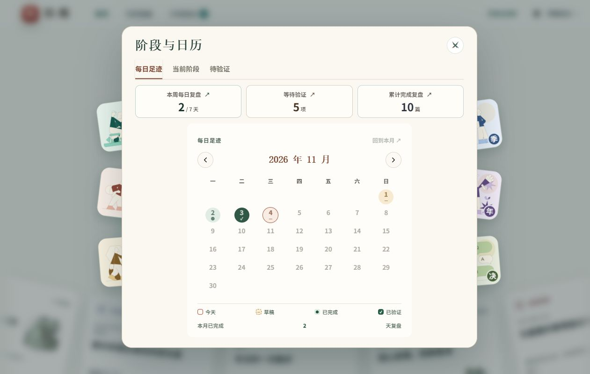
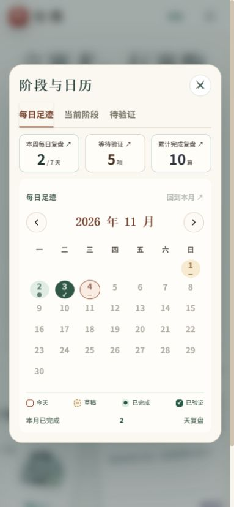

# shadcn/ui 接入验收

日期：2026-11-04。浏览器使用隔离的本地合成账户和数据库；截图中的记录、统计和账户均为测试资料。

## 自动检查

- 锁文件干净安装：`npm ci --offline --no-audit --no-fund`，151 个依赖安装成功。
- `npm run build`、`npm run check`、`npm test`：通过，108/108 项测试成功。
- `npm run smoke:ui -- http://127.0.0.1:3192`：健康、HTML、主脚本、组件 JS/CSS 及媒体类型通过。
- 17 项真实组件 DOM 回归，加上 6 项来源导航测试，覆盖原生字段／FormData、单次事件、隐藏答案、组件清理、勾选框、菜单、日历、嵌套与持久弹窗、背景隔离、退出登录清理和来源返回。
- 本机没有 Docker；Linux 镜像构建、容器启动和真实前端资源检查由仓库 `Verify build` CI 验证。

## 浏览器检查

| 范围 | 已核实行为 |
| --- | --- |
| 登录／首次注册 | 真实 Card、Input、Label、Button、Checkbox；显示密码同步；已有测试账户登录成功；首次注册表单只检查展示，未创建新管理员 |
| 概览 | 桌面六类同排、原配色与品牌、弧形连续轮播、图片加载；减少动态效果切换为静态列表 |
| 六类复盘 | 各类引导和逐题填写、原位输入、草稿保存；每日数值和选择、答案新增后折叠、成对预案；决策标题错误定位 |
| 验证日期 | 中文 DayPicker、六周、浏览不选日、选日保存；周 7／月 30／季 90／年 250 天与决策三个月的原下限；320px 日格 30px，页面不横向溢出 |
| 历史／行动 | 搜索和类型年月控件、长正文转义、真实组件；从原复盘退出回到来源并恢复卡片焦点与滚动；已有已验证记录只读 |
| 阶段弹窗 | 760px 居中、Tabs 切换、日历状态；应用背景 inert；重复进入阶段设置子弹窗，关闭子层回到父触发器，最后关闭恢复顶部按钮 |
| 主题／设置 | 全白自定义颜色仍可读、可见焦点、颜色输入同步、勾选框同步；恢复标准主题并关闭减少动态效果 |
| 备份／管理员 | 原生字段和真实 Table／Card／Badge；窄屏表格重排；未执行密码更改、权限变更或破坏性恢复 |
| 响应式 | 320、390、820、1280px 检查；手机 DropdownMenu、日历、历史与管理员布局；820px 六类同排 |
| 控制台 | 最终应用检查无 warning/error；可见插画加载成功 |

完成确认和验证表单在浏览器中打开后取消。自动审批拒绝了永久锁定合成记录的最终操作；没有重试或通过接口绕过。锁定约束、验证日期与安全行为通过自动化测试及已有只读记录核查。

## 截图

[桌面概览](overview-desktop.png) · [桌面阶段日历](stage-desktop.png) · [手机阶段日历](stage-mobile.png) · [手机历史列表](history-mobile.png) · [桌面行动验证](actions-desktop.png) · [首次注册桌面](register-desktop.png) · [首次注册手机](register-mobile.png)

