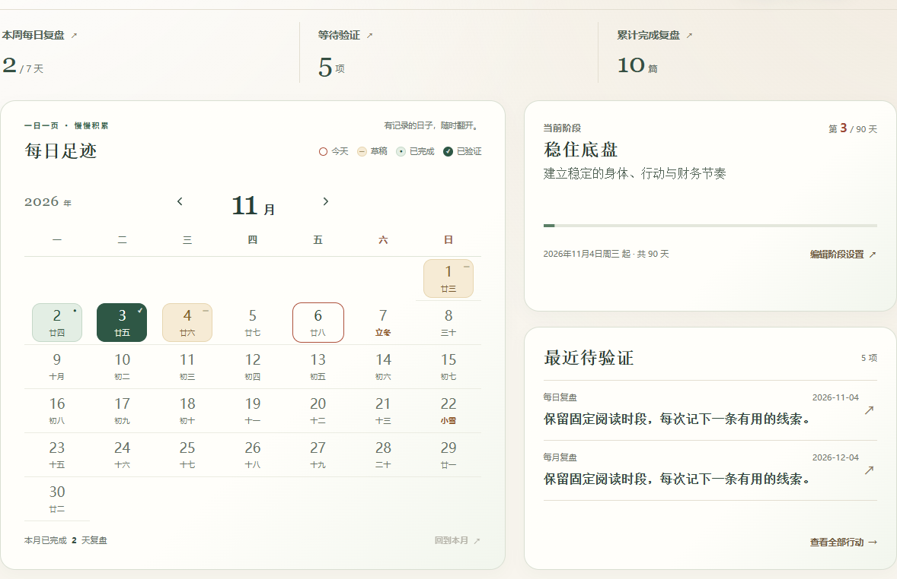

# 阶段与日历验收

2026-11-06。仅修改阶段与日历页面，使用独立 headless Google Chrome 和既有隔离合成数据库。空记录、长行动、300字阶段说明通过测试上下文的只读响应替换；未修改真实记录、账户、设置或浏览器资料。

- DayPicker仍管理日期、月份、键盘和焦点。阶段页的日期行改为七个等宽Grid轨道，六周/42格，当月每个日期唯一，外月格为空，不依赖collapse table绘制。
- 标题与图例属于同一个组件/标题网格。桌面图例与「每日足迹」中心线差0–0.01px；年份单独放在导航区域左侧，月份只显示月，完整年月仍保留在可访问caption中。821/850/900/1051px临界检查无年份/箭头重叠，可访问树保留grid/rowgroup/row/gridcell及完整日期名称。
- 桌面三项标签13.68px、数值36px，分别从原10.98px和24.3px放大。样式只作用阶段页。
- 1280/1100/960px，左日历与右两卡合计上下边界差均0px。820px自然重排、390/320px垂直布局，无横向溢出。空列表与两条长行动预览通过；长行动只在此处列表截行，原数据完整。
- 合法300字阶段说明曾挤出底部动作并压扁进度条，独立检查发现后已修复：行最小尺寸尊重内容、说明仅预览三行、进度/底部禁止收缩。1280/1100/960/850/821/820/390/320px复测，底部动作均在卡片内，进度条保持4px，完整300字仍在DOM和原数据中。
- 11月30个日期、12月31个日期、跨年1月31个日期均唯一；切月不选择日期，原月份按钮焦点不丢。日历打开原记录、退出回原日期焦点通过。空日历80%/110%/125% CSS缩放截图无重复字形；系统减少动效状态可用。
- build / check / 150项测试 / 本地健康与JS/CSS资源烟测通过，最终构建控制台无warning/error。独立复核无剩余发现；共享验证日历、六类复盘、概览、历史与行动页面源码未更改。

用户截图的旧版右缘重复字形未在本地基线同样复现；本次明确更换阶段日期几何布局，但不能据此声称已确认用户环境的具体绘制根因。

## 效果

[手机日历](mobile-calendar.png) · [空月历125%缩放](empty-zoom-1.25.png) · [300字阶段说明](long-stage-821.png)

## 证据

[最终几何](final-geometry.json) · [空与长行动](variant-geometry.json) · [300字阶段说明](long-stage-geometry.json) · [基线几何](baseline-geometry.json)

main精确SHA与CI将在同步后记录；Trellis归档和日志单独提交。
