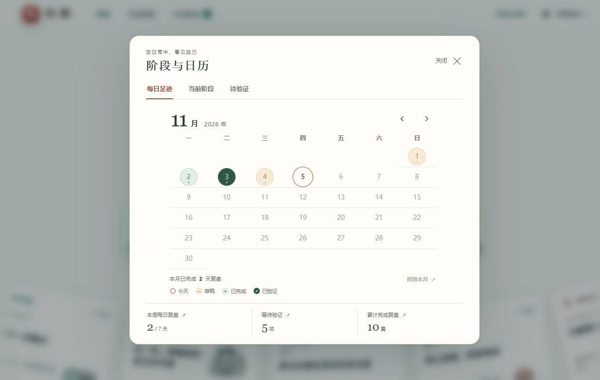
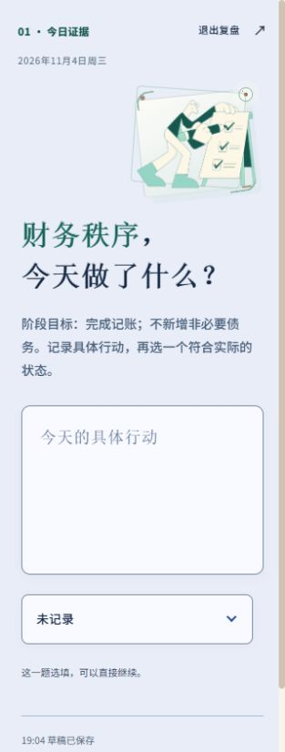

# 控件修正与新版阶段日历验收

验收日期：2026-11-04 至 2026-11-05。浏览器使用隔离的本地合成账户与数据库，截图不含真实复盘资料。

## 本次修改

- 状态与历史筛选选择框各保留一个箭头；原生选项、字段与提交方式不变。
- 六类问题标题统一按中文逗号、句号分行，保留标点、强调色与完整语义。长分句在手机自然折行，不插入未转义 HTML。
- 文字按钮、账户触发器与菜单项取消悬停矩形底色，当前项用文字和下划线表示；键盘焦点、正常主按钮及日期状态底色保留。
- 阶段与日历改为单张书页，取消左右六类卡片。大月份、六周日历、状态图例与底部统计形成清晰层级；三页签保留已挂载内容。
- 修复受控切月时 Calendar 根组件引用变化引发的整树重建，月份按钮节点与键盘焦点保持稳定。

## 自动检查

- `npm run check`、生产 `npm run build` 和 `npm test` 通过，**112/112** 项测试成功。
- 新标题测试覆盖保留标点、跨分句强调、空值／数字兼容和 HTML 样式标题的安全文本处理。
- 真实组件 DOM 测试覆盖阶段／验证两种日历的根节点与月份按钮身份、键盘焦点、连续跨年切月且不选择日期，以及三个持久页签、单统计页脚和无侧卡。
- 原父子 Dialog、背景 inert、返回焦点、只读、字段／草稿、来源返回及日期等待规则测试保持通过。
- `git diff --check`、本地健康与真实前端资源 smoke 通过；Docker 由推送后的 GitHub CI 核实。

补充的 premium 静态审计保留在 Trellis 任务研究目录。原始 strict 审计返回 15 项，并非全部通过：其中包括缺少机器声明、对原生监听／Radix 动作的误报，以及未由本次引入的 textarea／滚动条规则差异。分类报告逐项记录依据，不以该审计代替真实组件与浏览器检查。

## 浏览器检查

| 范围 | 已核实 |
| --- | --- |
| 用户截图对应的问题 | 财务指标标题两行、单箭头状态框；1280px 与 320px 无横向溢出或重叠 |
| 六类复盘 | 每日及周／月／季／年／决策共用标题处理；窄屏各类首题保持原文、配色与自然折行 |
| 原生选择框 | 选项可展开，选项名称／键盘／禁用行为保留；控件只呈现一个箭头 |
| 透明反馈 | 账户触发器悬停透明；Portal 菜单键盘高亮透明；当前页仍有字重与下划线 |
| 阶段日历 | 1280×800、820×600、390×844、320×640；无侧卡，背景锁定，页面不横向溢出；月历完整显示，统计和图例没有被截断 |
| 导航与记录 | 月份浏览、回到本月、键盘连续切月跨年；已有已验证日期打开原记录并保持只读 |
| 弹层与页签 | 每日足迹／当前阶段／待验证切换；重复进入阶段设置子框，取消后回到原触发器；最后关闭回到顶部按钮，背景 inert 正确解除 |
| 资源与控制台 | 实际插画加载；最终 warning/error 为空 |

全白主题和减少动态效果的持久保存验收被自动审批拒绝，理由是未明确授权的持久设置更改；已取消表单，没有通过接口或脚本绕过。本轮不声称重新完成这项主题保存验收。现有主题／减少动态契约及独立日期与焦点规则通过源码审查。

## 截图

[桌面标题与状态框](review-title-desktop.png) · [手机标题与状态框](review-title-mobile.png) · [透明账户入口](header-hover.png) · [桌面阶段日历](stage-desktop.png) · [手机阶段日历](stage-mobile.png)

